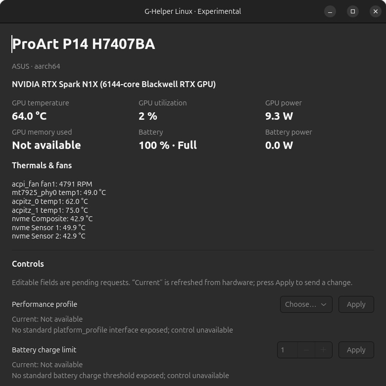

# G-Helper Linux — experimental native fork

Native GTK4 application and headless CLI for ASUS laptop telemetry and explicitly requested, capability-gated controls. This is a fork of [seerge/g-helper](https://github.com/seerge/g-helper), not an official Linux release by its maintainer. It is not the Windows executable running under Wine.

## Scope

The first target is the ASUS ProArt P14 H7407BA with NVIDIA RTX Spark N1X on Linux ARM64. The Windows application remains in `app/`; its original documentation is in [docs/README.md](docs/README.md). The Linux implementation is in [linux/](linux/README.md).

- Native GTK4 dashboard, live NVIDIA readings, battery status, kernel temperatures and fan RPM.
- Headless JSON diagnostics without GTK, serial numbers or product keys.
- Explicit profile, charge-limit and keyboard operations only when the kernel/device exposes the relevant capability and permissions allow it.
- Unsupported readings are shown as unavailable, never fabricated.
- No hardware changes on startup, refresh, diagnosis or GUI smoke tests.

This is an initial experimental implementation, not full feature parity. On the P14's current kernel the standard profile, charge-limit and keyboard LED interfaces are absent. HID keyboard access is normally root-only and its Linux commands still need an explicit hardware-validation session. Manual fan control, CPU/GPU power limits and undervolting are intentionally not enabled.

## Run from this checkout



```sh
./linux/bin/g-helper-linux
./linux/bin/g-helper-linux --json
./linux/bin/g-helper-linux --smoke-test
```

Python 3.10+ is required. The GUI additionally needs distro-provided PyGObject and GTK4; the source launcher uses `/usr/bin/python3` for that reason. See [setup, controls and safety](linux/README.md).

## Development

```sh
PYTHONPATH=linux python3 -m unittest discover -s linux/tests -v
GHELPER_GUI_TEST=1 PYTHONPATH=linux /usr/bin/python3 -m unittest discover -s linux/tests -v
```

Tests use labelled fixtures; the application itself has no demo-data mode. See the Linux README for hardware verification limits and the Windows support branch. The [read-only REA investigation](docs/reverse-engineering/proart-p14.md) records the unbound ACPI device and the kernel keyboard-listener limitation separately from verified app behavior.

## License and attribution

Upstream G-Helper and this fork are distributed under the GNU GPL v3; see [LICENSE](LICENSE). Upstream contributors retain their copyright. The Linux keyboard protocol is derived from the upstream ASUS HID implementation; the P16/N1X research in [PR 6218](https://github.com/seerge/g-helper/pull/6218) and [issue 6223](https://github.com/seerge/g-helper/issues/6223) informs the hardware investigation, not a claim that P14 fan commands have been validated.
